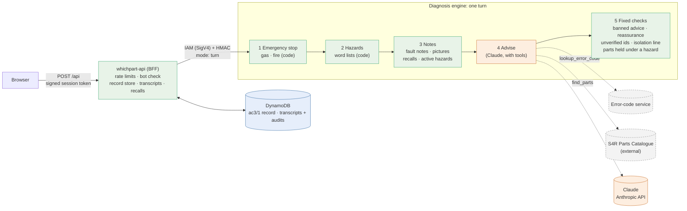

# Appliance Clinic

[](https://github.com/timdodgson/appliance-clinic/actions/workflows/build-and-test.yml)

**Appliance Clinic is an AI diagnostic service for UK household appliances, currently a proof of concept with no real customers. One capable model, Claude, is the advisor: it reads the conversation and our notes, looks up error codes and parts itself, and writes the reply. Code owns the safety rules around it.**

An owner describes a fault in their own words ("dyson v6 pulsing", "my washing machine is full of water"). The goal of every chat is the right outcome, safely and in as few messages as possible:
- a fix they can do themselves;
- the right part for their model;
- a clear reason to call an engineer; or
- reassurance that it is normal.

It covers washing machines, washer-dryers, tumble dryers, dishwashers, fridges and freezers, ovens and cookers, hobs, microwaves and vacuum cleaners, on AWS Lambda behind a CloudFront site. This repository holds the runtime, the web front end, the infrastructure as code (AWS CDK), the evaluation sets, and the record of how the service was separated from the monorepo and AWS account it was born in.

## The story in short

| Step | What happened |
|---|---|
| 1. Journeys | 63 deterministic journeys (fixed check order, closed vocabulary). The internal suite (GOLD) passed 56/56 |
| 2. Independent test | A blind 100-case benchmark: **a general-purpose assistant won 94–6** ([report](docs/evaluation/independent-100-case-benchmark.md)) |
| 3. First rebuild | One LLM call doing the whole turn inside a heavy guardrail kernel: beat the journeys 83–17, still lost 17–83 to the general assistant ([results](docs/evaluation/llm-led-rebuild.md), [ADR 0020](docs/adr/0020-llm-led-diagnosis-with-deterministic-guardrails.md)) |
| 4. Pipeline | Small jobs per model (Qwen understands and writes, Jev labels), a fixed record, code deciding each reply ([ADR 0021](docs/adr/0021-understand-label-enrich-decide-reply.md)). Live 2026-10-13 |
| 5. Advisor | A code audit showed the pipeline's own steps were blocking parts and damaging replies ([audit](docs/evaluation/code-audit-2026-10-16/REPORT.md)). Replaced by one advisor model with tools inside the guardrail kernel ([ADR 0023](docs/adr/0023-one-advisor-model-with-tools-inside-the-guardrail-kernel.md)). Live since 2026-10-16: 22/22 scripted chats against 2/22 for the pipeline on the same messages |

## Architecture



Green boxes are deterministic code, orange are the model, blue is persistent state, dashed grey is a service called out of the turn.

**One customer message** (`services/diagnosis-engine/ac2/turn.js`):
1. **Receive.** The BFF checks rate limits and the bot check, verifies the session token, loads the chat's record (`ac3/1`: the appliance identity learnt so far, active hazards, the advisor's outcome) and looks up product recalls, then sends a signed turn to the engine.
2. **Emergency stop.** Gas or an active fire in the customer's words returns the fixed emergency wording before any model is called.
3. **Hazards.** Word lists find other hazards (burning, water on electrics, shock, supply trips, microwave arcing, damaged batteries), respecting negation and questions. A hazard's fixed warning is shown once; the advisor is told it is active.
4. **Notes.** Fault notes found by keyword, the pictures that go with them, recalls and the active hazards are appended to the latest message as notes the customer did not write.
5. **Advise.** Claude reads the whole conversation and the notes, calls `lookup_error_code` and `find_parts` when it needs to, and calls `send_reply` with the reply, what it learnt about the appliance, the part ids to show (from the catalogue only), the picture to show (from the notes only) and its outcome. The prompt asks for the most likely cause and one next step in under 120 words.
6. **Fixed checks.** Banned advice is removed; after a hazard that needs an engineer, reassurance is removed; part numbers and prices that did not come from the catalogue are removed; a step that opens something gets the isolation line; a part is held while a blocking hazard is active.
7. **Send.** The record keeps what the advisor learnt. If the advisor cannot run, the turn is an explicit "temporarily unavailable". There is no fallback answer.

The full picture is in [docs/architecture/overview.md](docs/architecture/overview.md).

### Services

| Service | Code | Runs as | Job |
|---|---|---|---|
| **Web front end** | `apps/web` | Static files in S3 `whichpart-web-<account>`, behind CloudFront at applianceclinic.ai | Chat, admin console, help pages, recall search ([apps/web/README.md](apps/web/README.md)) |
| **whichpart-api** (BFF) | `services/whichpart-api` | Lambda zip `whichpart-api`, behind CloudFront `/api*` | Turns, sessions and record storage, transcripts with per-turn audits, recalls, admin |
| **Diagnosis engine** | `services/diagnosis-engine` | Lambda zip `applianceclinic-diagnosis-engine`, IAM-authenticated Function URL | The turn above |
| **Error-code service** | `error-codes/mcp` (Python) | Lambda zip `applianceclinic-error-code-mcp` (ADR 0022) | Error-code meanings (MCP over HTTP) and the admin catalogue editor |

The Python orchestrator (`spares4repairs-diag-orchestrator`) is no longer in the request path: no AC service calls it. Its function still exists in the stack, and it still receives traffic from outside this repository (see the known risks below).

### External services

| Service | Used for | Called from |
|---|---|---|
| **Claude** (Anthropic Messages API; the model id is set in Admin → Settings) | The advisor (step 5) | Diagnosis engine |
| **S4R Parts Catalogue API** | Compatible parts for a model (`PARTS_FOR_MODEL_API`) | Diagnosis engine (`find_parts`) |
| **S4R Shop** | Product links (`S4R_PRODUCT_BASE_URL`) | whichpart-api |
| **Cloudflare Turnstile** | Bot check on a new conversation | Browser, whichpart-api |

The Spares4Repairs (S4R) parts catalogue and shop are third-party services to Appliance Clinic. The only relationship is outbound: AC calls them as a client.

**Naming.** Some production names predate the separation (`whichpart-api`, the `ac2/` folder, the credential secret `applianceclinic/production/openai`). They were kept on purpose: renaming a Lambda function, a table or a secret means replacing it.

## Where the model is, and is not

| Step | Model | Code |
|---|---|---|
| Emergency stop, hazards | none | word lists, fixed wording, gas/fire stop before any model call |
| Notes | none | keyword retrieval over the fault notes, media mapping, recall matching |
| Advise | Claude reads, looks up and writes | the tools it may call and what they return (catalogue, error-code service) |
| Fixed checks | none | banned-advice filter, reassurance filter after a hazard, unverified identifiers, isolation line, part held under a hazard |
| Parts | Claude asks `find_parts` | only parts the catalogue returned for the model can be shown |

The advisor's prompt is registered and versioned, with a CI guard ([prompts/README.md](prompts/README.md)).

## Safety model

- **Gas and an active fire end the chat** with the fixed emergency wording, before any model is called.
- **Other hazards** (burning, water on electrics, shock, supply trips, microwave arcing, damaged batteries, recalls) get fixed stop-use wording once. The chat continues with checks that are safe with the appliance off; the advisor is told the hazard is active and keeps within it.
- **Banned advice is removed from every reply**: live testing, opening a microwave casing, discharging capacitors, gas or refrigerant work, bypassing safety devices, running an appliance that smelt of burning.
- **Precautions travel with checks.** A reply that sends the customer to open, remove or clean something gets the isolation step if it lacks one.
- **No part without the catalogue.** A part card shows only a part `find_parts` returned for the customer's model, and never while a blocking hazard is active.
- **Instructions inside a customer message are ignored** by prompt. Four scripted prompt-injection cases (`INJ-*` in `evaluation/scripted/tests.json`) check this on every run (see the risks below).

## Evaluation and evidence

| Layer | What it shows |
|---|---|
| Runtime tests (`npm run test:runtime`) | Unit and contract suites, including the turn (`ac4-turn.test.mjs`), the fixed safety checks and the GOLD guardrail regression (the kernel contains an adversarial advisor) |
| Typecheck, lint, build equivalence | Strict declarations for the engine contract and the `ac3/1` record; rebuilt Lambda zips equal the deployed references |
| Scripted chats (`evaluation/scripted/`) | 22 fixed customer messages against the live services, with hand-written pass/fail expectations per reply. Change 23.2: 22/22; the previous pipeline: 2/22 on the same messages ([side by side](evaluation/scripted/SIDE-BY-SIDE.md)) |
| Earlier benchmarks | The independent 100-case benchmark and the held-out set, blind-judged against a general assistant ([journeys](docs/evaluation/independent-100-case-benchmark.md), [first rebuild](docs/evaluation/llm-led-rebuild.md), [pipeline](docs/evaluation/ac3-pipeline-results.md)). The judge scored overall impressions and missed the faults the code audit found; the harness and its outputs were removed in change 23.4, the frozen case sets and result files stay |
| Transcript audits | Each turn's timings, tools called, safety gates, part decision and outcome are stored, so real conversations show where to improve |

**GOLD is not a quality score.** A 56/56 GOLD system lost 94–6 to a general assistant. GOLD's scenarios survive only as deterministic regression inputs.

## Infrastructure and migration

Production runs in eu-west-1 under three CDK stacks with their own bootstrap ([ADR 0005](docs/adr/0005-dedicated-cdk-bootstrap.md)):
- **Imported in place.** The existing resources were *imported* into CloudFormation without recreation ([ADR 0004](docs/adr/0004-import-existing-resources-into-cdk.md)).
- **Reviewed change sets only.** Every production change since is one, made through [`infra/production/steps/change.sh`](infra/production/steps/change.sh): template equality, a change-set checker, a temporary least-privilege grant, then drift and no-op checks and a CloudTrail audit.
- **Configuration is code.** Every environment variable on every function is declared in `runtime-overrides.json`, and a drift check compares it with the live functions after every change.
- **Nothing deploys automatically.** CI has no production credentials.

Appliance Clinic began inside the Spares4Repairs monorepo and shared its AWS account. It was separated in phases, with production stable throughout:

| Phase | What happened |
|---|---|
| 0–1 | Ownership proven from CloudTrail; an admin-authorisation gap closed |
| 2–3 | Byte-identical code extraction; reproducible builds |
| 4–6 | Sandbox rehearsal of every import type; a gated CDK import of production |
| 7 | Dedicated auth, secrets and least-privilege IAM |
| 8–9 | Architecture cleanup; first GOLD-driven product fixes; public-repository readiness |
| 10–11 | A production truth audit, then one conversation state, signed internal fields and evaluation from real transcripts |
| 12–13 | Single owners for the remaining decisions; no hidden fallback path and no accepted test failures |
| 15 | A dedicated canonical diagnosis engine, IAM-authenticated and signed; the legacy diagnosis code deleted |
| 16–21 | Independent benchmark (lost 94–6), first LLM-led rebuild, then the pipeline (ADR 0021) live and the journey controller deleted |
| 22 | The error-code service as a Zip Lambda with the repaired dataset (ADR 0022); the retired image function released from the stack and deleted |
| 23 | The code audit, then one advisor model with tools (ADR 0023); the pipeline, Jev, the provider routing, the transcript review and the admin Test area removed; the review schedule and the unused feedback path released (changes 23.5, 23.6) |

The story, with its decisions and trade-offs, is in [docs/portfolio/project-story.md](docs/portfolio/project-story.md). The phase-by-phase evidence is in [docs/migration/](docs/migration/PLAN.md) and [docs/evaluation/](docs/evaluation/README.md).

## Known operational risks and limitations

Most of these need the account owner's decision. What each looks like and how to respond is in the [operational risks runbook](infra/production/README.md#operational-risks); the evidence is in [the project story](docs/portfolio/project-story.md#still-open).
- **Lambda concurrency quota is 10** for the whole AWS account, shared with another site. A real throttle happened on 2026-10-12 during GOLD. Fix: an account-level quota increase.
- **The engine alarms notify nobody.** `applianceclinic-diagnosis-engine-{FailedTurns,RefusedRequests,Errors,Throttles}` have no notification target. Fix: an AC-owned SNS topic and subscription.
- **One model provider.** Every turn needs the Anthropic API; a credential, quota or outage problem fails every turn explicitly, by design. Nothing alerts on the provider's error rate or on spend.
- **A small prompt-injection test set.** Out-of-scope requests and attempts to change the instructions are handled by the prompt alone; the scripted set has four such cases (`INJ-*`), all passing on 2026-10-16.
- **Customer photos are not yet proven live** end to end.
- **The old shared engine still runs in AC's AWS account**, on `ac-diagnosis-role` and AC secrets, for its external consumer. AC sends it no traffic and does not modify it, by design ([ADR 0019](docs/adr/0019-dedicated-canonical-diagnosis-engine.md)).
- **The retired orchestrator still receives traffic.** `spares4repairs-diag-orchestrator` has a public Function URL and no AC caller, yet CloudWatch counted 23,537 invocations between 2026-10-02 and 2026-10-16 (97 to 8,882 a day). The caller is not identified. It stays in the stack until it is; deleting it before then could break whoever calls it.

## Working on it

You need Node 20 (`>=20 <23`) and Python 3.12 (the error-code zip also fetches its pinned wheels from PyPI).

```bash
npm ci                    # root test and typecheck dependencies
npm --prefix tools/migration ci
npm run setup:python      # the two Python test environments, with production package versions
npm run test:runtime      # runtime suites; every test must pass
npm run typecheck
npm run lint              # migration tooling (ESLint)
npm run test:tooling      # migration tooling tests
npm run build:zips        # build both Lambda zips and compare them with build/reference/
(cd apps/web && npm ci && npm run check)   # web front end: lint, typecheck, tests, reproducible build
(cd apps/web && npm run serve)            # run the site locally against the live API (http://localhost:8080)
```

- **No credentials needed.** None of these commands needs AWS or model credentials.
- **Credentialed tooling.** The scripts under `infra/production/` and `evaluation/scripted/run.cjs` act on the live service. They are owner tools and must not be run casually ([CONTRIBUTING.md](CONTRIBUTING.md)).

## Documentation

| Topic | Where |
|---|---|
| Current architecture | [docs/architecture/overview.md](docs/architecture/overview.md) |
| Web front end: run, build, deploy, admin auth | [apps/web/README.md](apps/web/README.md) |
| History of the journey architecture (superseded) | [as-built](docs/architecture/as-built.md), [target](docs/architecture/target.md), [state ownership](docs/architecture/phase-11-state-ownership.md) |
| Configuration, error contracts | [configuration.md](docs/architecture/configuration.md), [error-handling.md](docs/architecture/error-handling.md) |
| Decisions | [docs/adr/](docs/adr/README.md) |
| The advisor prompt and its versioning | [prompts/README.md](prompts/README.md) |
| Evaluation | [docs/evaluation/](docs/evaluation/README.md) |
| Migration plan, results, runbooks | [docs/migration/PLAN.md](docs/migration/PLAN.md), [runbooks](docs/migration/runbooks/README.md) |
| Project story | [docs/portfolio/project-story.md](docs/portfolio/project-story.md) |
| Contributing, security | [CONTRIBUTING.md](CONTRIBUTING.md), [SECURITY.md](SECURITY.md) |
| Production changes and runbook | [infra/production/README.md](infra/production/README.md), [`change.sh`](infra/production/steps/change.sh), [CONTRIBUTING.md](CONTRIBUTING.md#production-changes) |
| Repository layout | [CONTRIBUTING.md](CONTRIBUTING.md#repository-layout) |

## Licence

Licensed under the [Apache License, Version 2.0](LICENSE). Copyright 2026 Tim Dodgson; see [NOTICE](NOTICE).
