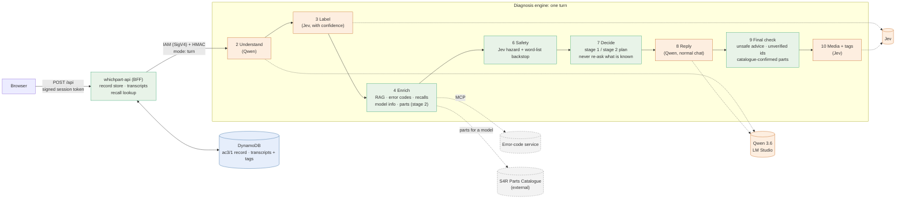

# Appliance Clinic

[](https://github.com/timdodgson/appliance-clinic/actions/workflows/build-and-test.yml)

**Appliance Clinic is an AI diagnostic service for UK household appliances, currently a proof of concept with no real customers. Each model has one small job: Qwen understands and writes, Jev labels. Code owns the record, safety, the plan for each reply and part recommendations.**

An owner describes a fault in their own words ("dyson v6 pulsing", "my washing machine is full of water"). The goal of every chat is the right outcome, safely and in as few messages as possible:
- a fix they can do themselves;
- the right part for their model;
- a clear reason to call an engineer; or
- reassurance that it is normal.

It covers washing machines, washer-dryers, tumble dryers, dishwashers, fridges and freezers, ovens and cookers, hobs, microwaves and vacuum cleaners, on AWS Lambda behind a CloudFront site. This repository holds the runtime, the web front end, the infrastructure as code (AWS CDK), the evaluation suites, and the record of how the service was separated from the monorepo and AWS account it was born in.

## The story in short

| Step | What happened |
|---|---|
| 1. Journeys | 63 deterministic journeys (fixed check order, closed vocabulary). The internal suite (GOLD) passed 56/56 |
| 2. Independent test | A blind 100-case benchmark: **a general-purpose assistant won 94–6** ([report](docs/evaluation/independent-100-case-benchmark.md)) |
| 3. First rebuild | One LLM call doing the whole turn inside a heavy guardrail kernel: beat the journeys 83–17, still lost 17–83 to the general assistant ([results](docs/evaluation/llm-led-rebuild.md), [ADR 0020](docs/adr/0020-llm-led-diagnosis-with-deterministic-guardrails.md)) |
| 4. Agreed design | Small jobs per model, a record with a fixed shape, code deciding each reply ([ADR 0021](docs/adr/0021-understand-label-enrich-decide-reply.md)). Live since 2026-10-13; the journey controller is deleted |

## Architecture



Green boxes are deterministic code, orange are models, blue is persistent state, dashed grey is a service called out of the turn.

**One customer message** (`services/diagnosis-engine/ac2/turn.js`):
1. **Receive.** The BFF checks the session token, loads the chat's record (`ac3/1`) and looks up product recalls, then sends a signed turn to the engine.
2. **Understand (Qwen).** A small call reads the latest message: appliance, brand, model, codes, symptom, question, answer, checks done. These are hints only.
3. **Label (Jev).** One call labels the message from the customer's own words, with a confidence per label: scope, appliance, make, model, code, symptom area, hazard, unsafe request, answer to the last question, check outcome, model label reachable, and, once checks are done, the narrowed component. Below threshold means "not stated".
4. **Enrich.** RAG (171 fault notes, the old journeys as knowledge, normal-behaviour notes), error-code meanings from the error-code service, recalls, model info, and in stage 2 the parts catalogue. Enrichment is kept apart from customer facts.
5. **Record.** The BFF saves the record. This turn's labels, stage, reply action and media are the transcript tags, so real chats show where to improve.
6. **Safety.** Jev's hazard label plus a word-list backstop. Gas or an active fire returns the fixed emergency wording before any model is called. Any other hazard shows the fixed wording once, and from then on only checks that are safe with the appliance off.
7. **Decide.** Code makes the plan. Stage 1 gives a broad answer and safe checks, with media, and asks no model number. Stage 2 starts when the owner's checks fail: get the model if it is missing and reachable, then the part. Never ask for anything already in the record.
8. **Reply (Qwen).** The conversation goes in as a normal chat, with a briefing: what we know, knowledge, plan.
9. **Final check.** Prohibited advice and unverified part numbers or prices are removed. A part card appears only when the catalogue confirms it for the customer's model.
10. **Media and tags (Jev).** Jev picks the picture or video for the reply's check and tags what the reply did.
11. **Send.** If Qwen or Jev cannot run, the turn is an explicit "temporarily unavailable". There is no fallback answer.

The full picture is in [docs/architecture/overview.md](docs/architecture/overview.md).

### Services

| Service | Code | Runs as | Job |
|---|---|---|---|
| **Web front end** | `apps/web` | Static files in S3 `whichpart-web-<account>`, behind CloudFront at applianceclinic.ai | Chat, admin console, help pages, recall search ([apps/web/README.md](apps/web/README.md)) |
| **whichpart-api** (BFF) | `services/whichpart-api` | Lambda zip `whichpart-api`, behind CloudFront `/api*` | Turns, sessions and record storage, transcripts with per-turn tags, recalls, admin, scheduled jobs |
| **Diagnosis engine** | `services/diagnosis-engine` | Lambda zip `applianceclinic-diagnosis-engine`, IAM-authenticated Function URL | The turn pipeline above |
| **Error-code service** | `error-codes/mcp` (Python) | Lambda image `spares4repairs-error-code-mcp` | Error-code meanings (MCP over HTTP) and the admin catalogue editor |

The Python orchestrator (`spares4repairs-diag-orchestrator`) is no longer in the request path. Its function still exists in the stack and receives no traffic.

### External services

| Service | Used for | Called from |
|---|---|---|
| **Qwen 3.6** (35B-A3B) on LM Studio, over a private tunnel | Understanding (step 2) and the reply (step 8) | Diagnosis engine |
| **Jev** (`typesafe/jev`, through Cloudflare AI Gateway) | Labels (step 3), media and reply tags (step 10), scheduled transcript review | Diagnosis engine, whichpart-api |
| **S4R Parts Catalogue API** | Compatible parts for a model (`PARTS_FOR_MODEL_API`) | Diagnosis engine |
| **S4R Shop** | Product links (`S4R_PRODUCT_BASE_URL`) | whichpart-api |

The Spares4Repairs (S4R) parts catalogue and shop are third-party services to Appliance Clinic. The only relationship is outbound: AC calls them as a client.

**Naming.** Some production names predate the separation (`whichpart-api`, `spares4repairs-error-code-mcp`, the `ac2/` folder). They were kept on purpose: renaming a Lambda function or a table means replacing it.

## Where the models are, and are not

| Step | Model | Code |
|---|---|---|
| Understand | Qwen reads the message (hints) | none |
| Label | Jev picks fixed labels with confidence | thresholds; below threshold = not stated |
| Enrich | none | RAG, error-code service, recalls, model info, parts catalogue |
| Safety | Jev's hazard label | word-list backstop, fixed wording, gas/fire stop, banned-advice filter |
| Decide | Jev for fuzzy questions (narrowed?) | stage, what to ask, what never to ask, when a part may be shown |
| Reply | Qwen writes | final check (unsafe advice, unverified identifiers) |
| Media | Jev picks the matching item | candidate media from the knowledge nodes |

Every prompt is registered and versioned, with a CI guard ([prompts/README.md](prompts/README.md)).

## Safety model

- **Hazards are found twice.** Jev labels hazards from the customer's words, and a word list catches what a model might miss (respecting negation such as "no burning smell").
- **Only gas and an active fire end the chat.** Both get the fixed emergency wording at once, before any model is called. Other hazards (burning, water on electrics, shock, supply trips, microwave arcing, damaged batteries, recalls) get fixed stop-use wording once. The chat then continues with checks that are safe with the appliance off.
- **Banned advice is removed from every reply**: live testing, opening a microwave casing, discharging capacitors, gas or refrigerant work, bypassing safety devices, running an appliance that smelt of burning.
- **Precautions travel with checks.** A reply that sends the customer to open, remove or clean something gets the isolation step if it lacks one.
- **No part without evidence.** A part card only in stage 2, when the fault is narrowed, the model is known, there is no blocking hazard, and the catalogue lists a matching part for that model.

## Evaluation and evidence

| Layer | What it shows |
|---|---|
| Runtime tests (`npm run test:runtime`) | Unit and contract suites, including the turn pipeline (`ac3-turn.test.mjs`) and the GOLD guardrail regression (an adversarial Qwen with a blind Jev is contained) |
| Typecheck, lint, build equivalence | Strict declarations for the engine contract and the `ac3/1` record; rebuilt Lambda zips equal the deployed references |
| Independent 100-case benchmark | Blind, judged comparisons with a strong general assistant ([journeys](docs/evaluation/independent-100-case-benchmark.md), [first rebuild](docs/evaluation/llm-led-rebuild.md)) |
| Live smoke chats | Multi-turn chats on the live site after each release (the 2026-10-13 results are in [ADR 0021](docs/adr/0021-understand-label-enrich-decide-reply.md)) |
| Transcript tags | Each turn's labels, stage, reply action, media and enrichment are stored, so real conversations show where to improve |

**GOLD is not a quality score.** A 56/56 GOLD system lost 94–6 to a general assistant. GOLD's scenarios survive only as deterministic regression inputs. Quality is judged on independent cases and, from now on, on real tagged transcripts.

## Infrastructure and migration

Production runs in eu-west-1 under three CDK stacks with their own bootstrap ([ADR 0005](docs/adr/0005-dedicated-cdk-bootstrap.md)):
- **Imported in place.** The existing resources were *imported* into CloudFormation without recreation ([ADR 0004](docs/adr/0004-import-existing-resources-into-cdk.md)).
- **Reviewed change sets only.** Every production change since is one, made through [`infra/production/steps/change.sh`](infra/production/steps/change.sh): template equality, a change-set checker, a temporary least-privilege grant, then drift and no-op checks and a CloudTrail audit.
- **Configuration is code.** Every environment variable on every function is declared in `runtime-overrides.json`, and a drift check compares it with the live functions after every change.
- **Nothing deploys automatically.** CI has no production credentials.

Appliance Clinic began inside the Spares4Repairs monorepo and shared its AWS account. It was separated in phases, with production stable throughout:

| Phase | What happened |
|---|---|
| 0–1 | Ownership proven from CloudTrail; an admin-authorisation gap closed |
| 2–3 | Byte-identical code extraction; reproducible builds |
| 4–6 | Sandbox rehearsal of every import type; a gated CDK import of production |
| 7 | Dedicated auth, secrets and least-privilege IAM |
| 8–9 | Architecture cleanup; first GOLD-driven product fixes; public-repository readiness |
| 10–11 | A production truth audit, then one conversation state, signed internal fields and evaluation from real transcripts |
| 12–13 | Single owners for the remaining decisions; no hidden fallback path and no accepted test failures |
| 15 | A dedicated canonical diagnosis engine, IAM-authenticated and signed; the legacy diagnosis code deleted |
| 16–21 | Independent benchmark (lost 94–6), first LLM-led rebuild, then the agreed pipeline (ADR 0021) live and the journey controller deleted |

The story, with its decisions and trade-offs, is in [docs/portfolio/project-story.md](docs/portfolio/project-story.md). The phase-by-phase evidence is in [docs/migration/](docs/migration/PLAN.md) and [docs/evaluation/](docs/evaluation/README.md).

## Known operational risks and limitations

Most of these need the account owner's decision. What each looks like and how to respond is in the [operational risks runbook](infra/production/README.md#operational-risks); the evidence is in [the project story](docs/portfolio/project-story.md#still-open).
- **Lambda concurrency quota is 10** for the whole AWS account, shared with another site. A real throttle happened on 2026-10-12 during GOLD. Fix: an account-level quota increase.
- **The engine alarms notify nobody.** `applianceclinic-diagnosis-engine-{FailedTurns,RefusedRequests,Errors,Throttles}` have no notification target. Fix: an AC-owned SNS topic and subscription.
- **Every turn needs Jev, and nothing alerts on Jev credit or quota.** Running out of Jev credit caused a real outage on 2026-10-11 ([finding](docs/evaluation/phase-13-results.md#operational-finding-jev-credit-exhaustion-took-production-down)).
- **Evaluation and production share one Jev account and credit.** GOLD and its judge can use up production's credit. Fix: a separate key or budget for evaluation.
- **The old shared engine still runs in AC's AWS account**, on `ac-diagnosis-role`, AC secrets and AC's Jev credit, for its external consumer. AC sends it no traffic and does not modify it, by design ([ADR 0019](docs/adr/0019-dedicated-canonical-diagnosis-engine.md)).
- **The LLM provider is a single point of failure.** Production reasoning runs on Qwen 3.6 served by LM Studio over a private tunnel; when the tunnel dropped on 2026-10-12 (about 20:25–21:19 UTC) turns failed explicitly, by design. Evaluation runs share the same provider, which serves one request at a time.
- **The error-code service has not been released with the repaired dataset** (64 records restored, Beko hob `U`). Live lookups use the unrepaired catalogue until it is, and CI's `images` check stays red.
- **Reply quality issues seen in the 2026-10-13 smoke chats:** after a burning smell, one reply said simple checks might avoid an engineer; after failed vacuum checks, one reply assumed "no sign of life". Both are prompt or plan fixes for the next engine release.

## Working on it

You need Node 20 (`>=20 <23`), Python 3.12 and, for images only, Docker with arm64 emulation.

```bash
npm ci                    # root test and typecheck dependencies
npm --prefix tools/migration ci
npm run setup:python      # the two Python test environments, with production package versions
npm run test:runtime      # runtime suites; every test must pass
npm run typecheck
npm run lint              # migration tooling (ESLint)
npm run test:tooling      # migration tooling tests
npm run build:zips        # build both Lambda zips and compare them with build/reference/
(cd apps/web && npm ci && npm run check)   # web front end: lint, typecheck, tests, reproducible build
(cd apps/web && npm run serve)            # run the site locally against the live API (http://localhost:8080)
```

- **No credentials needed.** None of these commands needs AWS or model credentials.
- **Credentialed tooling.** The scripts under `infra/production/` act on the live service. They are owner tools and must not be run casually ([CONTRIBUTING.md](CONTRIBUTING.md)).

## Documentation

| Topic | Where |
|---|---|
| Current architecture | [docs/architecture/overview.md](docs/architecture/overview.md) |
| Web front end: run, build, deploy, admin auth | [apps/web/README.md](apps/web/README.md) |
| History of the journey architecture (superseded) | [as-built](docs/architecture/as-built.md), [target](docs/architecture/target.md), [state ownership](docs/architecture/phase-11-state-ownership.md) |
| Configuration, error contracts | [configuration.md](docs/architecture/configuration.md), [error-handling.md](docs/architecture/error-handling.md) |
| Decisions | [docs/adr/](docs/adr/README.md) |
| Prompts and their versioning | [prompts/README.md](prompts/README.md) |
| Evaluation | [docs/evaluation/](docs/evaluation/README.md) |
| Migration plan, results, runbooks | [docs/migration/PLAN.md](docs/migration/PLAN.md), [runbooks](docs/migration/runbooks/README.md) |
| Project story | [docs/portfolio/project-story.md](docs/portfolio/project-story.md) |
| Contributing, security | [CONTRIBUTING.md](CONTRIBUTING.md), [SECURITY.md](SECURITY.md) |
| Production changes and runbook | [infra/production/README.md](infra/production/README.md), [`change.sh`](infra/production/steps/change.sh), [CONTRIBUTING.md](CONTRIBUTING.md#production-changes) |
| Repository layout | [CONTRIBUTING.md](CONTRIBUTING.md#repository-layout) |

## Licence

Licensed under the [Apache License, Version 2.0](LICENSE). Copyright 2026 Tim Dodgson; see [NOTICE](NOTICE).
