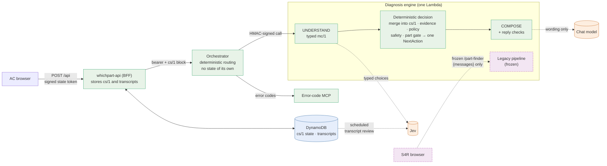

# Appliance Clinic

[](https://github.com/timdodgson/appliance-clinic/actions/workflows/build-and-test.yml)

**Appliance Clinic is a production, AI-assisted diagnosis service for household appliances. Language models understand the customer and word the replies. Deterministic code owns the conversation state, the diagnosis, safety and part recommendations.**

An owner describes a fault in their own words ("it's making a grinding noise when it tries to empty"). The service then:
- asks one useful question at a time;
- walks them through safe checks;
- explains the likely cause;
- points to the right part, or to an engineer.

It covers nine appliance families (washing machines, washer-dryers, tumble dryers, dishwashers, fridge-freezers, ovens, hobs, microwaves and vacuums) through 63 canonical diagnostic journeys. A journey is one fault on one appliance family (for example "washing machine not draining"), with its own evidence model, check order, safety requirements and part gate. It runs on AWS Lambda behind a CloudFront site. This repository holds the production runtime, its infrastructure as code (AWS CDK), the evaluation suites, and the full record of how the service was moved out of the monorepo and AWS account it was born in, with production stable throughout.

## What this project demonstrates

- **Models with fixed jobs.** The models classify and word replies; code decides. Safety stops and part recommendations never depend on model prose ([ADR 0010](docs/adr/0010-deterministic-policy-around-llm.md)).
- **Typed model output as control input.** The understanding model answers multiple-choice questions with scored choices, so code can validate it. An answer below its commit threshold is not committed as a fact; where it matters, the customer is asked one disambiguating question.
- **One authoritative conversation state.** `cs/1` is the only state, with explicit, tested transitions ([ADR 0014](docs/adr/0014-cs1-is-the-only-conversation-state.md), [field map](docs/architecture/phase-11-state-ownership.md)).
- **Evaluation driven by production transcripts.** Real conversations exposed failures that green tests missed, and those failures were turned into benchmark scenarios and regression tests ([findings](docs/evaluation/phase-10-transcript-findings.md)).
- **A benchmark that is audited, not trusted.** GOLD whole-conversation scenarios are judged by a fixed model on a rubric with critical failures. The suite itself was checked against real failures.
- **Root-cause fixes, not test gaming.** No threshold was lowered. A scenario was changed only when an audit showed the test itself was wrong. Each failing GOLD run was traced to a product defect and fixed at its layer ([Phase 11 results](docs/evaluation/phase-11-results.md#gold)).
- **Imported, not recreated.** Live AWS resources were imported into CDK without recreation or downtime, after a sandbox rehearsal of every resource type ([ADR 0004](docs/adr/0004-import-existing-resources-into-cdk.md)).
- **A live external consumer preserved.** A sister site's endpoint is served by the same engine. Its contract was frozen and checked before and after every release ([ADR 0003](docs/adr/0003-s4r-compatibility-boundary.md)).
- **Security as a contract.** Least-privilege IAM, rotated secrets, and HMAC-signed internal fields on a public endpoint ([ADR 0017](docs/adr/0017-authenticate-orchestrator-only-engine-fields.md), [SECURITY.md](SECURITY.md)).
- **Reviewed production releases.** Every change is a checked change set with a temporary least-privilege grant, drift detection, a no-op check and a CloudTrail audit ([`change.sh`](infra/production/steps/change.sh)).

## Architecture



Green boxes are deterministic code, orange are models, blue is persistent state, and dashed purple is the S4R compatibility path. A dotted arrow is a model call or the frozen legacy route. (The legacy pipeline also uses Jev and a chat model; the [overview](docs/architecture/overview.md) has the full picture.)

**One customer turn:**
1. The browser posts the latest message with a signed state token. The BFF rate-limits it and loads the `cs/1` state.
2. The orchestrator routes the turn. It keeps no conversation state: everything it needs comes from the request and the `cs/1` block. It calls the engine with HMAC-signed internal fields, and calls the error-code MCP when a code is involved.
3. The engine asks **Jev** to classify the latest message into the typed `mc/1` vocabulary. Deterministic code then:
   - merges the result into `cs/1`;
   - scores evidence for the owning journey;
   - chooses exactly one next action, with safety first;
   - gates any part recommendation.
4. COMPOSE has a chat model word that action. The reply is checked (one question, no invented parts, required safety lines, no instruction echo) and falls back to fixed copy if it fails.
5. The BFF stores the new `cs/1` and the transcript. A scheduled judge reviews production transcripts.

**Naming.** Several production names predate the separation: `whichpart-api`, `spares4repairs-part-finder`, `spares4repairs-diag-orchestrator`. They were kept on purpose, because renaming a Lambda function or a table means recreating it, and the migration imported resources rather than recreating them.

The same engine still serves the sister site Spares4Repairs (S4R) through a frozen legacy `/part-finder` contract. S4R sends only `{messages}` and never reaches the canonical path's internal fields. The full component, flow and ownership picture is in [docs/architecture/overview.md](docs/architecture/overview.md).

## Where the models are, and are not

| | Deterministic (code, unit-tested) | Probabilistic (models) |
|---|---|---|
| Understanding | the typed `mc/1` vocabulary; commit thresholds; the merge into `cs/1` | **Jev** classifies each message into that vocabulary |
| Deciding | journey diagnostics, next-action policy, safety stops, part gate | none |
| Wording | fixed copy for safety stops; template fallback; reply checks | a chat model words the chosen action |
| Facts | error codes (the MCP), part catalogue, safety copy | none |
| Judging quality | pass rules, thresholds | Jev as the GOLD judge and the transcript-review judge |

**Jev** (`typesafe/jev`, through Cloudflare AI Gateway) answers multiple-choice questions with typed, scored choices instead of free text. When it isn't sure, the consequence is deterministic. For example, a token that might be a code or a model number is held as unconfirmed, and the customer is asked one question.

Retrieval never supplies safety rules, error-code meanings, compatibility or stock; those come from typed sources. Every prompt is registered and versioned, with a CI guard ([prompts/README.md](prompts/README.md)).

## Safety model

- **Hazards stop the conversation.** A reported hazard (gas smell, burning, shock, water on electrics, sparking) produces a fixed stop-use message, never model prose. The stop stays in force for the rest of the conversation.
- **Precautions travel with checks.** Owner checks carry their own precautions, such as isolating the appliance or containing the water. A COMPOSE reply missing one gets it restored.
- **Some work is always for a professional.** Live testing, opening microwaves, gas work and bypassing safety devices are declined and handed to a qualified engineer.
- **No part without evidence.** The part gate needs the diagnosis to support a component. Exact fit needs the model number, and the reply says so when it is missing.

## Evaluation and production evidence

| Layer | What it shows |
|---|---|
| Runtime tests (`npm run test:runtime`) | Unit, contract and journey suites for every runtime, all of which must pass (no accepted-failure list) |
| Typecheck (`npm run typecheck`) | Strict TypeScript declarations for the `/part-finder` frames, `cs/1`, engine configuration and the prompt registry |
| Build equivalence (CI) | Rebuilt Lambda zips and container images equal the recorded references, file by file |
| `/part-finder` contract and smoke | Checked before and after every production release |
| **GOLD-v2.4** | 56 whole-conversation scenarios, judged by Jev on a 10-dimension rubric (`gold-v2-rubric-v3`) with critical failures |
| Production transcript review | A scheduled judge over real conversations; read by a person alongside GOLD |

**The latest gate (Phase 12) was 56/56 in two consecutive runs on the final build** ([results](docs/evaluation/phase-12-results.md#gold)), as was Phase 11's ([results](docs/evaluation/phase-11-results.md#gold)). That number is not the claim on its own. What matters is how it was reached:
- GOLD-v2.2 had passed 49/49 in four consecutive runs. Real conversations were still visibly poor.
- Reviewing production transcripts found failures the benchmark could not see. A model instruction was leaking into replies in scenarios that passed, and the suite had no error-code scenario at all, so a code mistaken for a model number went unseen.
- The benchmark was audited against those failures. Scenarios and rubric-wide fidelity checks were added from real evidence; nothing was removed or weakened ([audit](docs/evaluation/phase-10-gold-audit.md)).
- Each failure, in GOLD or in a transcript, was fixed in the product at its root and given a regression test.

Production transcript review stays a separate reality check. Its findings are read and recorded alongside GOLD, not folded into it.

**The judge is a model too.** GOLD and transcript review are judged by Jev, the same service that does the understanding. The rubric, judge prompt and pass rule are fixed and versioned, and runs are compared like for like. Critical failures are explicit. Verdicts are checked by reading the conversations: the first full run's audit found five test or judge defects and corrected them ([value audit](docs/evaluation/gold-v2-value-audit.md)). A judge independent of the understanding model would be stronger evidence, and is not in place.

## Infrastructure and migration

Production runs in eu-west-1 under three CDK stacks with their own bootstrap ([ADR 0005](docs/adr/0005-dedicated-cdk-bootstrap.md)):
- **Imported in place.** The existing resources were *imported* into CloudFormation without recreation ([ADR 0004](docs/adr/0004-import-existing-resources-into-cdk.md)).
- **Reviewed change sets only.** Every production change since is one, made through [`infra/production/steps/change.sh`](infra/production/steps/change.sh): template equality, a change-set checker, a temporary least-privilege grant, then drift and no-op checks and a CloudTrail audit.
- **Configuration is code.** Every environment variable on every function is declared in `runtime-overrides.json`, and a drift check compares it with the live functions after every change.
- **Nothing deploys automatically.** CI has no production credentials.

Appliance Clinic began inside the Spares4Repairs monorepo and shared its AWS account. It was separated in phases, with production stable throughout:

| Phase | What happened |
|---|---|
| 0–1 | Ownership proven from CloudTrail; an admin-authorisation gap closed |
| 2–3 | Byte-identical code extraction; reproducible builds |
| 4–6 | Sandbox rehearsal of every import type; a gated CDK import of production |
| 7 | Dedicated auth, secrets and least-privilege IAM |
| 8–9 | Architecture cleanup; first GOLD-driven product fixes; public-repository readiness |
| 10–11 | A production truth audit, then one conversation state, signed internal fields and evaluation from real transcripts |

The story, with its decisions and trade-offs, is in [docs/portfolio/project-story.md](docs/portfolio/project-story.md). The phase-by-phase evidence is in [docs/migration/](docs/migration/PLAN.md) and [docs/evaluation/](docs/evaluation/README.md).

## Known limitations

The list of current open items, each with its evidence, is in [the project story](docs/portfolio/project-story.md#still-open). The largest ones:
- The AWS account's Lambda concurrency pool (10) is shared with S4R, and a quota increase is recommended.
- The static site is still published from the original monorepo.
- Two diagnosis paths stay in the engine for S4R's sake.

## Working on it

You need Node 20 (`>=20 <23`), Python 3.12 and, for images only, Docker with arm64 emulation.

```bash
npm ci                    # root test and typecheck dependencies
npm --prefix tools/migration ci
npm run setup:python      # the two Python test environments, with production package versions
npm run test:runtime      # runtime suites; every test must pass
npm run typecheck
npm run lint              # migration tooling (ESLint)
npm run test:tooling      # migration tooling tests
npm run build:zips        # build both Lambda zips and compare them with build/reference/
```

- **No credentials needed.** None of these commands needs AWS or model credentials.
- **Credentialed tooling.** The GOLD runner (`tools/gold-v2/run-live.mjs`) and the scripts under `infra/production/` act on the live service. They are owner tools and must not be run casually ([CONTRIBUTING.md](CONTRIBUTING.md)).

## Documentation

| Topic | Where |
|---|---|
| Current architecture | [docs/architecture/overview.md](docs/architecture/overview.md) |
| How it got there: audit, target, state ownership | [as-built](docs/architecture/as-built.md), [target](docs/architecture/target.md), [state ownership](docs/architecture/phase-11-state-ownership.md) |
| Configuration, error contracts | [configuration.md](docs/architecture/configuration.md), [error-handling.md](docs/architecture/error-handling.md) |
| Decisions | [docs/adr/](docs/adr/README.md) |
| Prompts and their versioning | [prompts/README.md](prompts/README.md) |
| Evaluation | [docs/evaluation/](docs/evaluation/README.md) |
| Migration plan, results, runbooks | [docs/migration/PLAN.md](docs/migration/PLAN.md), [runbooks](docs/migration/runbooks/README.md) |
| Project story | [docs/portfolio/project-story.md](docs/portfolio/project-story.md) |
| Contributing, security | [CONTRIBUTING.md](CONTRIBUTING.md), [SECURITY.md](SECURITY.md) |

## Licence

Licensed under the [Apache License, Version 2.0](LICENSE). Copyright 2026 Tim Dodgson; see [NOTICE](NOTICE).
