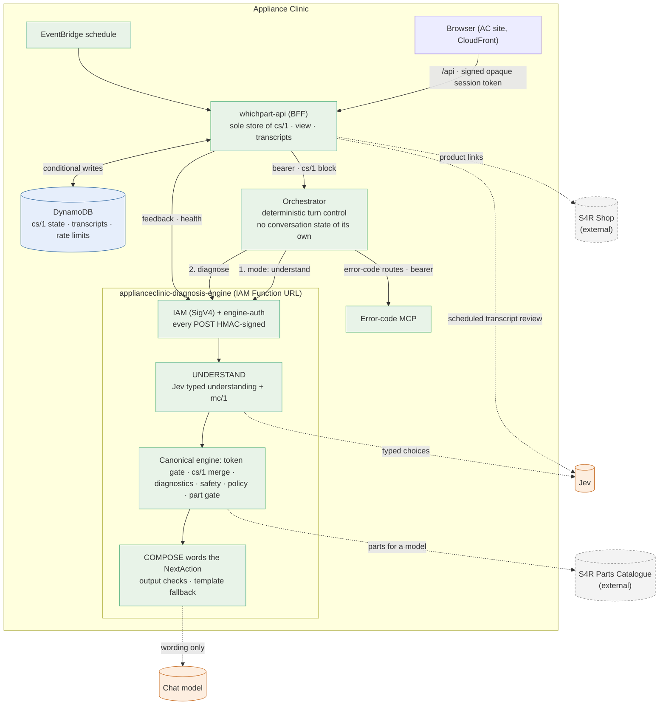

# Architecture overview

This describes the system as it runs in production after Phase 15. It is the one current-state architecture document.
The decisions behind it are in [`docs/adr/`](../adr/README.md).

How it got here is kept as evidence, not rewritten:
- [phase-8-findings.md](phase-8-findings.md) is the Phase 8 review that produced this page.
- The Phase 10 truth audit traced every hop from code and production evidence: [as-built.md](as-built.md), with the
  line-level [trace](as-built-trace.md).
- From that audit came the [target architecture](target.md).
- Phase 11 implemented the target's state and authentication steps, Phase 13 removed the hidden fallback
  ([ADR 0018](../adr/0018-no-ac-legacy-fallback.md)), and Phase 15 moved Appliance Clinic (AC) onto its own canonical
  diagnosis engine ([ADR 0019](../adr/0019-dedicated-canonical-diagnosis-engine.md);
  [results](../evaluation/phase-15-results.md)).

Green is deterministic code, orange is a model, blue is persistent state, dashed grey is an external service. Dotted
lines into an orange box are the only places a model is used.

## Where the language models are, and are not

| Step | Owner | Model? |
|---|---|---|
| Understand the latest message: typed understanding and the `mc/1` classification | Jev (`diagnosis.jev.understand`, `diagnosis.jev.mc1`) | Yes: typed choices, validated by code. A canonical turn makes **two** Jev calls in parallel |
| Merge into `cs/1` state, request outcomes | `canonical/merge.js`, `requests.js` | No |
| Diagnose (evidence against cause families) | `canonical/*-diagnostics.js`, `evidence-engine.js` | No |
| Choose the one next action; safety stops; part gate | `canonical/*-policy.js`, `policy-kit.js` | No |
| Turn control, routing, safety blocks, non-journey outcomes | orchestrator | No |
| Word the chosen action | canonical COMPOSE (`diagnosis.canonical.compose`) | Yes: then checked; template on failure; safety stops never |
| Error-code meaning | Error-code MCP | No |
| Transcript review, GOLD judge | Jev (`review.transcript.*`, `benchmark.gold-v2.judge`) | Yes, offline from the customer path |

## Components

| Component | Code | Runs as | Owns |
|---|---|---|---|
| **AC site** | `apps/web` (plain HTML/CSS/JS; [README](../../apps/web/README.md)) | Static files in S3 `whichpart-web-<account>` behind CloudFront, deployed by `apps/web/scripts/deploy.mjs` | Customer chat UI, admin UI, help pages, recall search. Talks only to the same-origin `/api`; admin sign-in goes through the BFF to the AC Cognito pool |
| **BFF** (`whichpart-api`) | `services/whichpart-api` | Lambda zip, Function URL, CloudFront `/api*` origin | Customer turns, AC sign-in, admin, scheduled jobs, canonical session state, transcripts, shop links |
| **Orchestrator** | `orchestration/` (Python) | Lambda image `spares4repairs-diag-orchestrator` (arm64) | Turn control: scope, routing, canonical control, non-journey outcomes, safety, identity. No language model. No conversation state of its own: each turn is built from the request and seeded from the cs/1 block ([ADR 0014](../adr/0014-cs1-is-the-only-conversation-state.md)). Reviewed in [orchestrator-review.md](orchestrator-review.md) |
| **Error-code MCP** | `error-codes/mcp` (Python) | Lambda image `spares4repairs-error-code-mcp` (arm64) | Error-code tools (MCP over HTTP), error-code admin catalogue |
| **Diagnosis engine** | `services/diagnosis-engine` | Lambda zip `applianceclinic-diagnosis-engine` (nodejs22.x, handler `handler.handler`), Function URL with `AWS_IAM` auth, buffered, no CORS | UNDERSTAND (Jev), the canonical journeys, decisions, COMPOSE ([ADR 0019](../adr/0019-dedicated-canonical-diagnosis-engine.md)) |

**Inside the diagnosis engine.** `handler.js` is the entry point. Around it:
- `canonical-runtime.js` and `canonical/` (the journeys, merge, diagnostics, policy, compose kit);
- `jev-understand.js`, `jev-client.js`, `jev-mc1.js`, `identity.js`;
- `engine-auth.js` (the signature check), `security.js` (output tripwire), `media.js` and `media-effective.js` (media
  selection and the admin overlay), `admin-config.js` and `inference.js` (providers), `health.js`;
- `engine/`: configuration, the fault catalogue, conversation helpers, reply filters, the learning log, and the
  **S4R Parts Catalogue client (external service)**.

`knowledge/` holds the knowledge corpus files. The engine does not read them at runtime; whichpart-api's read-only
knowledge view does.

**whichpart-api.** `index.js` holds the handler, the router and the customer diagnosis path. It has:
- base modules: `config`, `log`, `http-io`, `rate-limiting`, `session`, `s3`, `benchmark-state`, `transcript-store`,
  `engine-signature` (HMAC and SigV4 for engine calls)
- admin areas under `admin/`: `content` (read-only knowledge, and media), `recalls`, `transcripts`, `health`,
  `error-codes`, `diagnostics`, `test-area`, `settings`

Data: DynamoDB `whichpart-transcripts`, `whichpart-recalls`, `applianceclinic-rate-limits`; S3
`whichpart-learning-<account>` (learning traces and feedback, media overlays, test-area data).

## External services

| Service | Used for | Caller | Configuration |
|---|---|---|---|
| S4R Parts Catalogue API | Compatible parts for a confirmed model | Diagnosis engine | `PARTS_FOR_MODEL_API` |
| S4R Shop | Product links on part cards | whichpart-api | `S4R_PRODUCT_BASE_URL` |
| Jev (`typesafe/jev`, Cloudflare AI Gateway) | Typed understanding; GOLD and transcript judges | Diagnosis engine, whichpart-api | `applianceclinic/production/jev` |
| LM Studio (local), OpenAI (optional) | COMPOSE wording | Diagnosis engine | Admin AI configuration; `LM_STUDIO_URL` |

The Spares4Repairs (S4R) catalogue and shop are third-party services. The only relationship is outbound: AC calls them
as a client.

## Request flows

**AC customer turn**

1. Browser → CloudFront `/api/...` → `whichpart-api`. The browser sends the conversation it shows (customer and
   assistant turns, up to 12) and a signed state token; the chat route itself is not authenticated, only rate-limited.
2. `whichpart-api` loads the conversation state, applies the rate limit, and calls the orchestrator with its bearer,
   attaching the canonical cs/1 block.
3. The orchestrator seeds the turn from the cs/1 block (identity, displayed code, unconfirmed token, model status,
   active safety level), then calls the diagnosis engine (`DIAGNOSIS_ENGINE_URL`) twice. Each call is SigV4-signed and
   carries an HMAC signature over the exact body:
   - `mode: understand`: Jev reads the latest message; the engine merges it into cs/1 and decides the NextAction. The
     reply is one JSON line `{type:'understand', understand, jev, canonical?}`.
   - diagnose: served only when a canonical journey controls the turn, otherwise `409 canonical_not_controlled`. The
     reply is `{type:'delta'}` then `{type:'done'}`.

   On error-code routes it also calls the MCP with its bearer.
4. `whichpart-api` maps the result to the WhichPart view, persists the transcript and the new state (conditional
   write), and returns. The cs/1 merge itself runs in the engine's understand call; the BFF stores the result and
   re-merges only to recover one missed write.

Engine responses are buffered JSON lines, internal to AC; they are not streamed.

**Feedback and health:** `whichpart-api` posts customer feedback to the engine (`ENGINE_URL`, SigV4 and HMAC) and the
admin Diagnostics view probes `GET /health` (SigV4). Health returns `{status, health, healthReason,
service:'diagnosis-engine', version, canonical:{journeys}, models, media}`; the view shows it as the "Diagnosis engine"
component.

**Admin request:** browser → `/api/admin/...` → `whichpart-api`, which checks an AC Cognito session in the `admin` group
before any admin handler runs.

**Scheduled jobs (EventBridge → `whichpart-api`):** recall ingest and transcript review.

## State ownership

| State | Owner | Notes |
|---|---|---|
| Conversation state (`cs/1`: identity, evidence, requests and their outcomes, sticky hazards, declines) | Merged by the engine (`canonical/merge.js`), stored only by `whichpart-api` (DynamoDB `STATE#`, conditional writes) | The only conversation state ([ADR 0014](../adr/0014-cs1-is-the-only-conversation-state.md)). Versioned schema; additive fields only |
| Code versus model for an uncertain token | The engine: one commit rule before the merge (`canonical/token-gate.js`) | A weak or unplaced reading is held as `identity.unconfirmedToken`; the customer's answer commits it. The decision reaches the orchestrator as `understand.tokenDecision`, and the orchestrator has no thresholds of its own (Phase 12) |
| Customer-facing label of a canonical cause | The engine (`canonical/cause-summary.js`) | Sent as `conclusion.summary` on the NextAction; the orchestrator passes it through as `diagnosis.label`, and an unlabelled cause gets none, never its raw key (Phase 12) |
| Orchestrator turn state | Request-local | Rebuilt every turn from the request and the cs/1 block; nothing survives the turn, so two instances given the same request decide the same way (tested) |
| Transcripts | `whichpart-api` | Read by the scheduled review and the admin area |

A turn that could not run its decision path is an error in the view and the transcript, and its state change is not
persisted ([ADR 0016](../adr/0016-degraded-turns-are-errors.md)). Every orchestrator field and where it now lives is in
[phase-11-state-ownership.md](phase-11-state-ownership.md).

## Decision paths

| Path | Status | Reached by |
|---|---|---|
| Canonical control (`services/diagnosis-engine/canonical/*`, orchestrator canonical branch) | **The only diagnosis path** | AC turns on allow-listed journeys. `whichpart-api` runs `CANONICAL_MODE=control` with `CANONICAL_CONTROL_JOURNEYS` listing them |
| Orchestrator non-journey outcomes (`_flow_hazard`, `_flow_unsafe_request`, `_flow_error_code`, `_flow_unsupported`, `_flow_clarify`) | **Canonical boundary** ([ADR 0018](../adr/0018-no-ac-legacy-fallback.md)) | AC turns no journey controls: cs/1 hazard → safety stop; unsafe request → fixed decline; displayed code → error-code MCP only; typed problem → `UNSUPPORTED`; nothing typed → intake. None of them diagnoses |
| Legacy diagnosis code (pipeline, legacy COMPOSE, retrieval, unsigned `{messages}` contract) | **Deleted from AC** in Phase 15 ([ADR 0019](../adr/0019-dedicated-canonical-diagnosis-engine.md)) | Nothing. Git history keeps it |
| Admin knowledge publishing (draft, validate, versions, publish, rollback, archive, restore) | **Removed** in Phase 15: it only fed the deleted retrieval index. The routes return 404; read-only knowledge inspection stays | Nothing |

A canonical degradation (missing block, degraded or malformed canonical result, degraded understanding, a diagnose
reply without the engine's `canonicalControl` proof, a failed diagnose) is an explicit `SERVICE_UNAVAILABLE`; nothing is
persisted and no other path answers ([ADR 0018](../adr/0018-no-ac-legacy-fallback.md)). `CANONICAL_MODE=shadow` (no
journey controls a turn) or `off` (no cs/1 block, so every AC turn is an explicit error) is not a rollback; dropping one
journey key from `CANONICAL_CONTROL_JOURNEYS` (or `CANONICAL_Jx_CONTROL=0`) makes that journey's turns `UNSUPPORTED`.
Rollback of a release is the previous code or image. The live mode and allow-list (control, 63 journeys, equal to the
registry) are declared in `runtime-overrides.json` with every other environment variable, and a drift check compares
them with the live function after every runtime change.

### The old shared engine

`spares4repairs-part-finder` (Function URL auth `NONE`, CORS `*`) was the shared engine before Phase 15. It is left
physically untouched and still serves S4R, an external consumer. AC sends it no traffic after the cutover. Its CDK
ownership was relinquished with zero physical change (change 15.3; [Phase 15 results](../evaluation/phase-15-results.md)).

**Residual coupling.** It still runs in AC's AWS account, on `ac-diagnosis-role`, with AC secrets and AC's Jev credit.
Changing any of those would modify resources it depends on, which Phase 15 deliberately does not do.

## Authentication

| Boundary | Mechanism |
|---|---|
| Customer browser → `whichpart-api` | No authentication on the chat route; rate limit by hashed key. The cs/1 state token is HMAC-signed (`applianceclinic/production/canonical-state-token`; the previous-key slot still names the old `spares4repairs/dev/applianceclinic-canonical-state-token`) |
| Admin browser → `whichpart-api` | AC Cognito user pool (`AcAuthStack`), group `admin`; the BFF checks it per request |
| `whichpart-api` → orchestrator | Bearer `applianceclinic/production/orchestrator-bearer` |
| `whichpart-api`, orchestrator → MCP | Bearer `applianceclinic/production/mcp-bearer` |
| Orchestrator (`diag-orchestrator-role`), `whichpart-api` (`whichpart-api-role`) → diagnosis engine | **IAM:** the Function URL is `AWS_IAM`; the inline policy `ac-invoke-diagnosis-engine` lets each role invoke only that URL, and every call is SigV4-signed (service `lambda`). **HMAC:** every POST carries `x-ac-engine-signature` over the exact body (5-minute window, constant-time compare; key `applianceclinic/production/engine-signing`; [ADR 0017](../adr/0017-authenticate-orchestrator-only-engine-fields.md)). An unsigned or wrongly signed request is refused with `401 engine_signature_required`. There is no anonymous path and no CORS ([ADR 0019](../adr/0019-dedicated-canonical-diagnosis-engine.md)) |
| Engine → Jev, OpenAI | Provider credentials from `applianceclinic/production/{jev,openai}` |

The engine's own role, `ac-diagnosis-engine-role`, can write only its own log group, call `GetSecretValue` on
`applianceclinic/production/{ai-config,openai,jev}`, put objects under `learning/feedback/*` and read `media-admin/*`.

## Secrets and configuration

- **Secrets** live in Secrets Manager under `applianceclinic/production/*` (`AcDataStack`).
  - Lambdas receive secret **ids** in environment variables, never values.
  - Bearers are resolved through CloudFormation dynamic references.
  - The old `spares4repairs/dev/applianceclinic-*` secrets keep their historical names where they still exist. They are
    not deleted, because the old shared engine's defaults and one AC slot still name them: the previous-key slot of
    the state token (`CANONICAL_TOKEN_PREVIOUS_SECRET_ID`).
  - The legacy bearer secrets (`spares4repairs/{diag-orchestrator,error-code-mcp}/bearer-token`) were deleted in
    Phase 9 ([phase-9-results.md](../migration/phase-9-results.md)).
- **Configuration** is environment variables on each Lambda, owned by `AcRuntimeStack` (`infra/cdk/config/runtime-overrides.json`).
  - Every live variable is declared there, including the canonical mode and journey allow-list; a private tunnel URL is
    recorded by SHA-256 only.
  - Changing a value is a CDK change, not a console edit.
  - `tools/migration/bin/check-overrides-drift.mjs` compares the declaration with the live functions; `change.sh`
    runs it after every runtime change and fails on any difference.
- **Admin-editable AI settings** (models, prompts toggles) are stored in the `ai-config` secret and written by the
  Settings page.
- **Every environment variable** each runtime reads is listed in [configuration.md](configuration.md): required or
  optional, its default, and whether production sets it. The defaults that still point at production or S4R are listed
  there too. A test fails on an undocumented variable.

## Prompts and contracts

- **Prompts.** Every prompt is registered in [`prompts/registry.json`](../../prompts/registry.json) with a stable id,
  version, purpose, contract and changelog ([ADR 0013](../adr/0013-prompt-registry-and-contract-types.md);
  [`prompts/README.md`](../../prompts/README.md) explains how to change one). The three legacy COMPOSE prompts were
  removed with the legacy code in Phase 15.
- **Contract types.** [`types/`](../../types/) declares the diagnosis-engine request and response lines
  (`types/diagnosis-engine.d.ts`), cs/1, the engine configuration and the prompt registry. `npm run typecheck` (CI job `typecheck`) checks the runtime against them under strict TypeScript.
- **Errors.** Each boundary's error contract is described in [error-handling.md](error-handling.md).

## Evaluation

| Check | What it covers | When |
|---|---|---|
| Runtime tests (`npm run test:runtime`) | Unit, contract and journey suites: 163 files, all passing at Phase 15. Every test must pass: there is no accepted-failure list (Phase 13). Files deliberately removed are recorded under `removed` in `runtime-changes.json` | Every pull request |
| Build equivalence (CI) | The `applianceclinic-diagnosis-engine` and `whichpart-api` zips and the images equal their `build/reference/` records | Every pull request |
| Live AC journeys and production checks | AC endpoints, auth, bearer and journey checks against the deployed build | Before and after every runtime release |
| Transcript review judge | Semantic review of production conversations (`review.transcript.*` prompts), summarised by `overall` from the `transcript-review-ok` log events | Scheduled; compared before and after releases |
| GOLD v2 | Semantic whole-conversation benchmark (GOLD-v2.4, 56 scenarios, rubric `gold-v2-rubric-v3`) with Jev as the fixed judge (`benchmark.gold-v2.judge`). Latest gate: 56/56 in two consecutive runs on the Phase 15 build, `main` at `10ab5ff` ([results](../evaluation/phase-15-results.md#gold)). Exactly two runs, 20 minutes apart, on the deployed build; no exploratory runs | Owner-run (admin test area, or `tools/gold-v2/run-live.mjs`); needs the live transport and Jev credentials |
| Live transcript review | Realistic journeys through the public AC path, ended so the production judge reviews them; both the judge's result and the conversation are read ([Phase 11](../evaluation/phase-11-results.md#transcript-review-live-final-build)) | After each phase's releases |

Behaviour is never scored by regular expressions; semantic judgement uses the Jev or language-model judges above.
(Behaviour is still *produced* by regular expressions in places, such as safety cues and brand lists; see
[as-built Q10](as-built-trace.md#q10-regex--string-matching-used-as-behaviour-most-significant).) The transcript-review
provider is configurable (`TRANSCRIPT_REVIEW_PROVIDER`; production: `jev`).
[ADR 0009](../adr/0009-evaluation-strategy.md) has the strategy.

## Infrastructure ownership (CDK)

| Stack | Holds |
|---|---|
| `AcAuthStack` | AC Cognito user pool, app client, `admin` group |
| `AcDataStack` | DynamoDB tables, S3 learning and web buckets, `applianceclinic/production/*` secrets, ECR repositories |
| `AcRuntimeStack` | The AC Lambda functions (`whichpart-api`, the orchestrator, the error-code MCP, `applianceclinic-diagnosis-engine`), their Function URLs and permissions, execution roles and policies, the engine's log group, metric filters and alarms, EventBridge schedules. The old shared engine's ownership outcome is in the [Phase 15 results](../evaluation/phase-15-results.md) |
| AC CDK toolkit | Bootstrap for the above ([ADR 0005](../adr/0005-dedicated-cdk-bootstrap.md)) |

Not owned: the CloudFront distribution ([ADR 0008](../adr/0008-cloudfront-initially-unmanaged.md)), and everything S4R
owns ([ADR 0003](../adr/0003-s4r-compatibility-boundary.md); [ownership.md](../migration/ownership.md)).

Every production change goes through `infra/production/steps/change.sh`:

1. synthesise
2. template equality check
3. change set with the checker
4. temporary least-privilege execution policy and stack policy
5. execute
6. drift and no-op check
7. restore

## Runbook and rollback

- **Health:**
  - `infra/production/verify-ac-endpoints.sh`
  - `verify-ac-auth.sh`
  - the engine's `GET /health` (SigV4), shown as "Diagnosis engine" in the admin Diagnostics view
  - alarms `applianceclinic-diagnosis-engine-FailedTurns` (5 or more failed turns in 5 minutes), `-RefusedRequests` (any
    unsigned or wrongly signed request), `-Errors` and `-Throttles`. **No notification target exists yet**: an alarm can be in ALARM with nobody told
    ([operational risks](../../infra/production/README.md#operational-risks))
  - the S4R contract, ingress, smoke and S4R health gates are retired from the AC change process
- **Runtime code release:**
  - build the zip with `build/scripts/package_zips.py`
  - deploy through a `change.sh` spec that sets `functions.<name>.code`
  - update `build/reference/*.zip.json` in the same pull request (CI requires the built zip to equal it)
  - register added, changed or removed runtime files in `docs/migration/runtime-changes.json`
- **Rollback:** revert the pull request and run the same change with the previous artefact. Each release spec records
  the previous code SHA-256. The published Lambda version `1` of `whichpart-api` is a further rollback point.
- **Jev is a shared single dependency.**
  - AC, GOLD, the transcript judge and the old shared engine (still used by S4R) all use one Jev account.
  - HTTP 402 from Jev means the credit is exhausted. AC then returns its explicit diagnosis error (`503 engine_unavailable`
    from the engine).
  - Recovery is a top-up, not a deploy. Then check one AC diagnosis and the engine's health
    ([Phase 13 finding](../evaluation/phase-13-results.md#operational-finding-jev-credit-exhaustion-took-production-down)).
  - Space GOLD runs, and run only those that are needed.
- **Account Lambda concurrency is 10**, shared with another site. A throttle shows as a 429 from the engine and the
  `-Throttles` alarm; the orchestrator retries a 429 once. The fix is an account quota increase (owner). These risks,
  with symptoms, checks and actions, are in the [operational risks runbook](../../infra/production/README.md#operational-risks).
- Phase runbooks: [`docs/migration/runbooks/`](../migration/runbooks/README.md).
