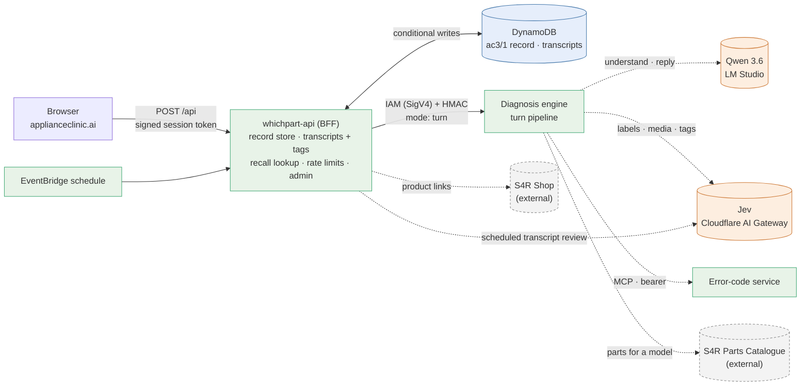
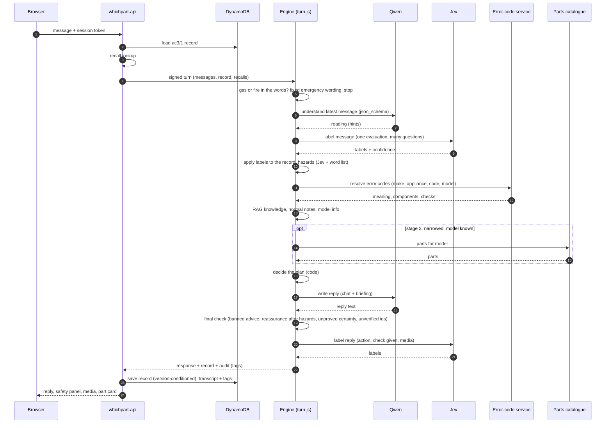
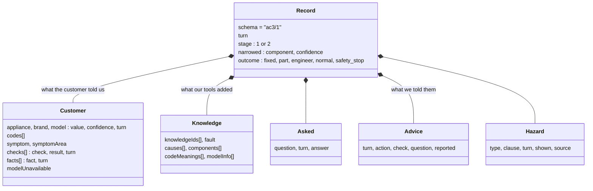
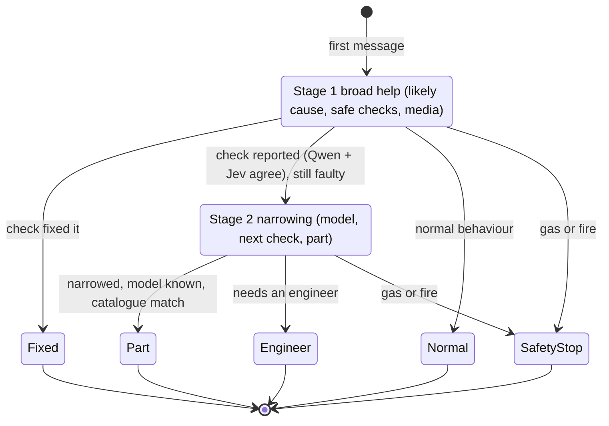
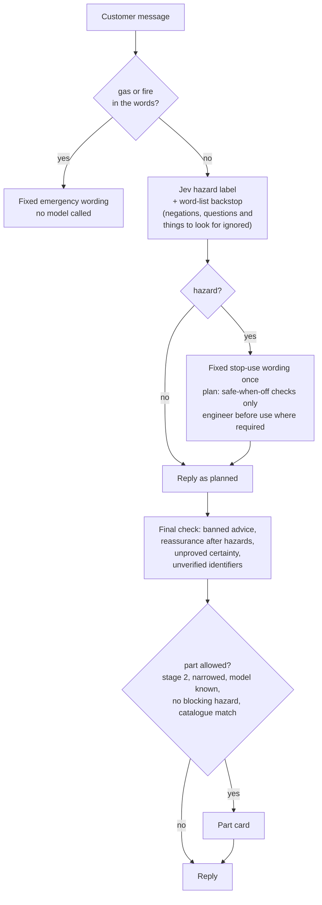

# Architecture overview

This is the one current-state architecture document: the system as it runs since changes 21.2–21.7 (2026-10-13).
The decision is [ADR 0021](../adr/0021-understand-label-enrich-decide-reply.md); the history that led to it is at the end.

Appliance Clinic is a proof of concept with no real customers yet.

## Principle

**Each model has one small job; code owns the record, safety, the plan for each reply and part recommendations.**

- **Qwen** (Qwen 3.6 35B-A3B on LM Studio) reads each message and writes each reply.
- **Jev** (`typesafe/jev`) gives fixed labels with a confidence, so every fact in the record has a known shape and a
  known certainty. It is used wherever a decision is fuzzy ("is this a hazard?", "is the fault narrowed?").
- **Code** keeps the record, runs the tools, applies safety, decides what the reply must do, checks the reply, and
  decides whether a part may be shown.

## Components

Green is deterministic code, orange is a model, blue is persistent state, dashed grey is an external service.

| Component | Code | Runs as | Responsibility |
|---|---|---|---|
| Web front end | `apps/web` | S3 + CloudFront | Chat, admin console, help pages, recall search |
| whichpart-api (BFF) | `services/whichpart-api` | Lambda zip | Sessions, the `ac3/1` record (`ac2-state.js`), the turn call (`ac2-turn.js`), transcripts with per-turn tags, recalls, admin, scheduled jobs |
| Diagnosis engine | `services/diagnosis-engine` | Lambda zip, IAM Function URL | The turn pipeline (`ac2/turn.js`) and its steps |
| Error-code service | `error-codes/mcp` | Lambda image | Error-code meanings over MCP; the admin catalogue editor |

The Python orchestrator function still exists in the stack but is no longer called. The `ac2/` folder name is
historical: it now holds the ADR 0021 pipeline.

## One turn

| Step | What happens | Where |
|---|---|---|
| Understand | Qwen extracts appliance, brand, model, codes, symptom, question, answer, checks reported and facts stated (including what is not happening). Hints only | `ac2/understand.js` |
| Label | Jev: scope, appliance, make/model/code among candidate tokens, symptom area, hazard, unsafe request, answer to the last question, check outcome, model label reachable, narrowed component; and a yes/no confirmation of each check and fact Qwen read, so a misreading is never recorded. Below threshold = not stated | `ac2/labels.js` |
| Enrich | RAG over fault notes, the old journeys as knowledge and normal-behaviour notes; error codes via MCP; recalls; model info; parts (stage 2) | `ac2/knowledge.js`, `ac2/mcp.js`, `ac2/models.js`, `ac2/parts.js` |
| Safety | Jev's hazard label plus the word-list backstop; fixed wording once; gas or fire stops before any model | `ac2/safety.js`, `ac2/turn.js` |
| Decide | The plan for the reply (below) | `decide()` in `ac2/turn.js` |
| Reply | Qwen writes from the conversation and a briefing | `ac2/reply.js` |
| Final check | Banned advice, reassurance after a hazard, certainty no check has proved ("confirms", "definitely" softened), unverified part numbers and prices | `ac2/turn.js`, `ac2/safety.js` |
| Media and tags | Jev picks the matching picture or video and labels what the reply did and which check it gave | `ac2/labels.js` |

## The record (`ac3/1`)

Stored by the BFF in `whichpart-transcripts` (`AC2STATE#<csid>`), written with a version condition so two concurrent
turns cannot both advance it. A record in an earlier format is replaced, not failed.

Customer facts and tool knowledge are kept apart, so a RAG guess is never recorded as something the customer said. A
check or fact Qwen reads is recorded only when Jev confirms it in the customer's words; the reply is told to treat
those as true, never contradict them and never ask about them again. Each piece of advice keeps whether the customer
has reported back on its check, so a reply never assumes a result.
The record's shape is checked against its TypeScript declaration at compile time (`types/check/conformance.ts`).

## Stages and outcomes

The plan for each reply is decided in code (`decide()`), from the record:
- answer the customer's question first;
- after a hazard, say what it means (an engineer's check before use, where that applies) and only suggest checks that
  are safe with the appliance off;
- list what they were already told and build on it; list the checks still awaiting a result and never imply they were
  done; if the latest message adds nothing new, give the next step;
- list the checks they reported with what they found; keep to the symptom they reported;
- stage 1: what could cause it, most likely first, as possibilities (including settings, loading, installation or
  normal behaviour), then the one or two safe checks or the one question that best separates them; no model number
  asked;
- an error code the catalogue cannot resolve: say its meaning cannot be confirmed, never guess;
- stage 2: ask for the make and model (saying where the label usually is) if it is missing and reachable; otherwise the
  next discriminating check, or the part when the catalogue confirms one for that model;
- never ask for anything already in the record, or a question they could not answer.

## Safety

## Failure behaviour

- **No fallback.** If Qwen or Jev cannot run, the turn is an explicit "temporarily unavailable" with a retry; the
  record is not advanced. Set-up failures are deferred to first use, so a gas or fire stop still answers.
- **Error-code service down:** the code is reported as not resolved; nothing is invented.
- **Parts catalogue down or no match:** no part card; the reply says a confirmed match was not found.
- **Record conflict** (two turns at once): the second turn is refused, not merged.

## Security

- The BFF calls the engine's IAM-authenticated Function URL (SigV4) and HMAC-signs every request body
  ([ADR 0017](../adr/0017-authenticate-orchestrator-only-engine-fields.md)); the engine refuses anything else.
- Secrets are in AWS Secrets Manager under `applianceclinic/production/*`, pinned by version in the deployment
  configuration, never in code or logs.
- Least-privilege roles per function; every production change is a reviewed change set
  ([`change.sh`](../../infra/production/steps/change.sh)).

## Observability

- **Per-turn audit** (engine log and transcript): timings per step, provider, safety gates, part decision, the plan.
- **Transcript tags**: Jev's labels with confidence, stage, what the reply did, the check given, media, enrichment
  used. This is how real chats show where to improve: low-confidence labels, stalls, missing knowledge or media.
- **Admin console**: transcripts with the per-turn audit and tags.
- Engine alarms: failed turns, refused requests, errors, throttles (no notification target yet; see the README risks).

## Evaluation

- Runtime tests: the pipeline (`ac3-turn.test.mjs`), the GOLD guardrail regression (an adversarial Qwen with a blind
  Jev is contained), the BFF record store and transcript audit.
- The independent 100-case benchmark, the held-out set and the real-journey add-on set, blind-judged against a general
  assistant ([evaluation index](../evaluation/README.md)).

## Configuration

Every environment variable is in [configuration.md](configuration.md) and declared in
`infra/cdk/config/runtime-overrides.json`; the error contracts are in [error-handling.md](error-handling.md).

## History

Kept as evidence, superseded by this page:
- [phase-8-findings.md](phase-8-findings.md), [as-built.md](as-built.md) and its [trace](as-built-trace.md),
  [target.md](target.md), [phase-11-state-ownership.md](phase-11-state-ownership.md),
  [orchestrator-review.md](orchestrator-review.md): the journey architecture, its audit and its target.
- [ADR 0019](../adr/0019-dedicated-canonical-diagnosis-engine.md): the dedicated engine for the journeys.
- [ADR 0020](../adr/0020-llm-led-diagnosis-with-deterministic-guardrails.md) and its
  [evaluation](../evaluation/llm-led-rebuild.md): the first LLM-led rebuild.
