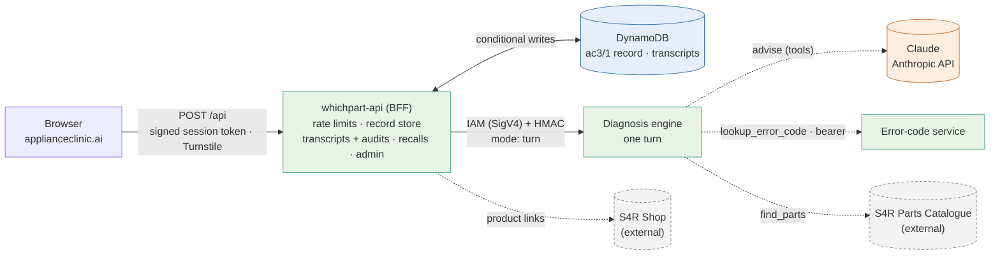
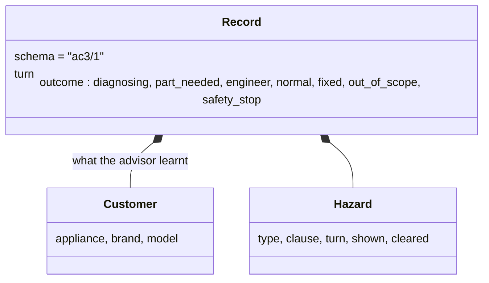

# Architecture overview

This is the one current-state architecture document: the system as it runs since changes 23.1–23.4 (2026-10-16).
The decision is [ADR 0023](../adr/0023-one-advisor-model-with-tools-inside-the-guardrail-kernel.md); the history that
led to it is at the end.

Appliance Clinic is a proof of concept with no real customers yet.

## Principle

**One capable model is the advisor; code owns the safety rules around it.**

- **Claude** (the Anthropic Messages API; the model id is set in Admin → Settings) reads the whole conversation and
  Appliance Clinic's notes, looks up error codes and parts with tools, and writes each reply.
- **Code** stops the chat on gas or fire, finds hazards, assembles the notes, checks every reply against fixed safety
  rules, and decides whether a part may be shown (catalogue only, never under a blocking hazard).

## Components



Green is deterministic code, orange is the model, blue is persistent state, dashed grey is an external service.

| Component | Code | Runs as | Responsibility |
|---|---|---|---|
| Web front end | `apps/web` | S3 + CloudFront | Chat, admin console, help pages, recall search |
| whichpart-api (BFF) | `services/whichpart-api` | Lambda zip | Rate limits and the bot check, sessions, the `ac3/1` record (`ac2-state.js`), the turn call (`ac2-turn.js`), transcripts with per-turn audits, recalls, admin |
| Diagnosis engine | `services/diagnosis-engine` | Lambda zip, IAM Function URL | The turn (`ac2/turn.js`), the advisor (`ac2/advisor.js`), the fixed safety checks (`ac2/safety.js`) |
| Error-code service | `error-codes/mcp` | Lambda zip `applianceclinic-error-code-mcp` (ADR 0022) | Error-code meanings over MCP; the admin catalogue editor |

The Python orchestrator function still exists in the stack. No AC service calls it, but its public Function URL still
receives traffic from an unidentified caller (the README's known risks has the measured figure), so it stays. The
`ac2/` folder name is historical: it now holds the ADR 0023 turn.

## One turn

```mermaid
sequenceDiagram
  autonumber
  participant B as Browser
  participant W as whichpart-api
  participant D as DynamoDB
  participant E as Engine (turn.js)
  participant A as Claude (advisor.js)
  participant X as Error-code service
  participant C as Parts catalogue
  B->>W: message + session token (+ Turnstile token on a new chat)
  W->>W: rate limit, bot check, verify the token
  W->>D: load ac3/1 record
  W->>W: recall lookup
  W->>E: signed turn (messages, record, recalls)
  E->>E: gas or fire in the words? fixed emergency wording, stop
  E->>E: hazards (word lists); fixed warning once
  E->>E: notes: fault notes, pictures, recalls, active hazards
  E->>A: conversation + notes, with tools
  opt the advisor looks things up
    A->>X: lookup_error_code
    X-->>A: meaning
    A->>C: find_parts (model)
    C-->>A: parts
  end
  A-->>E: send_reply (reply, appliance learnt, part ids, picture id, outcome)
  E->>E: fixed checks (banned advice, reassurance after a hazard, unverified ids, isolation line, parts held under a hazard)
  E-->>W: response + record + audit
  W->>D: save record (version-conditioned), transcript + audit
  W-->>B: reply, safety panel, media, part card
```

| Step | What happens | Where |
|---|---|---|
| Emergency stop | Gas or an active fire in the customer's words: the fixed emergency wording, no model call | `ac2/turn.js`, `ac2/safety.js` |
| Hazards | Word lists (negation, questions and things to look for ignored); a hazard stays active until the customer denies it; its fixed warning is shown once | `ac2/turn.js`, `ac2/safety.js` |
| Notes | Fault notes by keyword (BM25 over the notes), the pictures mapped to them, recalls whichpart-api found, the active hazards; appended to the latest customer message as notes the customer did not write | `ac2/knowledge.js`, `ac2/runtime.js`, `ac2/turn.js` |
| Advise | One model call with `lookup_error_code`, `find_parts` and `send_reply`; one more call per round of lookups. The reply: most likely cause, one next step, under 120 words; builds on the conversation; never invents a part number, price or model | `ac2/advisor.js`, `inference.js` |
| Fixed checks | Banned advice removed; after a hazard that needs an engineer, reassurance removed; part numbers and prices not from the catalogue removed; the isolation line added to a step that opens something; a part held under a blocking hazard | `ac2/safety.js`, `ac2/turn.js` |
| Record and audit | The record keeps the appliance identity learnt, the hazards and the outcome; the audit keeps timings, token usage, tools called, gates fired, the part decision, escalation and tags | `ac2/record.js`, `ac2/turn.js` |

## The record (`ac3/1`)

Stored by the BFF in `whichpart-transcripts` (`AC2STATE#<csid>`), written with a version condition so two concurrent
turns cannot both advance it. A record written by the earlier pipeline keeps its turn, hazards and what it knew; the
rest is dropped (`ac2/record.js load`).



The advisor reads the conversation itself, so the record holds only what must survive a turn. Its shape is checked
against its TypeScript declaration at compile time (`types/check/conformance.ts`).

## Safety


## Failure behaviour

- **No fallback.** If the advisor cannot run (credential, quota, outage, timeout), the turn is an explicit "temporarily
  unavailable" with a retry; the record is not advanced. Set-up failures are deferred to first use, so a gas or fire
  stop still answers.
- **Error-code service down:** `lookup_error_code` reports the code as not found; the advisor says it cannot confirm
  the meaning and works from the symptoms.
- **Parts catalogue down or no match:** no part card; the advisor says a confirmed match was not found.
- **Record conflict** (two turns at once): the second turn is refused, not merged.

## Security

- The BFF calls the engine's IAM-authenticated Function URL (SigV4) and HMAC-signs every request body
  ([ADR 0017](../adr/0017-authenticate-orchestrator-only-engine-fields.md)); the engine refuses anything else.
- Customer turns are rate-limited per client and per session (change 21.37) and a new conversation needs a passing
  Cloudflare Turnstile token (change 21.38).
- Secrets are in AWS Secrets Manager under `applianceclinic/production/*`, pinned by version in the deployment
  configuration, never in code or logs. The advisor's credential is write-only from the admin.
- Least-privilege roles per function; every production change is a reviewed change set
  ([`change.sh`](../../infra/production/steps/change.sh)).
- Instructions inside a customer message are ignored by prompt; there is no automated prompt-injection test set yet.

## Observability

- **Per-turn audit** (engine log and transcript): timings, token usage, provider and model, the tools called, the
  safety gates that fired, the part decision, escalation, the outcome and the enrichment used.
- **Admin console**: the dashboard (health, today's activity, production state), conversations with the per-turn
  audit, a live test workbench, knowledge, media, error codes, recalls, diagnostics and settings.
- Engine alarms: failed turns, refused requests, errors, throttles (no notification target yet; see the README risks).

## Evaluation

- Runtime tests: the turn (`ac4-turn.test.mjs`), the fixed safety checks, the GOLD guardrail regression (the kernel
  contains an adversarial advisor), the BFF record store, view and transcript audit.
- Scripted chats against the live services (`evaluation/scripted/run.cjs`): 22 fixed customer messages with
  hand-written pass/fail expectations per reply ([evaluation index](../evaluation/README.md)).

## Configuration

Every environment variable is in [configuration.md](configuration.md) and declared in
`infra/cdk/config/runtime-overrides.json`; the error contracts are in [error-handling.md](error-handling.md).

## History

Kept as evidence, superseded by this page:
- [phase-8-findings.md](phase-8-findings.md), [as-built.md](as-built.md) and its [trace](as-built-trace.md),
  [target.md](target.md), [phase-11-state-ownership.md](phase-11-state-ownership.md),
  [orchestrator-review.md](orchestrator-review.md): the journey architecture, its audit and its target.
- [ADR 0019](../adr/0019-dedicated-canonical-diagnosis-engine.md): the dedicated engine for the journeys.
- [ADR 0020](../adr/0020-llm-led-diagnosis-with-deterministic-guardrails.md) and its
  [evaluation](../evaluation/llm-led-rebuild.md): the first LLM-led rebuild.
- [ADR 0021](../adr/0021-understand-label-enrich-decide-reply.md) and its
  [evaluation](../evaluation/ac3-pipeline-results.md): the understand / label / decide / reply pipeline, and the
  [code audit](../evaluation/code-audit-2026-10-16/REPORT.md) that retired it.
